# UI 一致性对照

React 端使用 Tauri 命令与 `AppStore`，没有 mock 数据。所有页面与弹窗都在 `Apps/desktop/src` 中。

## 页面

| SwiftUI 基线 | React 实现 | 行数 | 说明 |
| --- | --- | ---: | --- |
| `HomeView.swift` | `pages/HomePage.tsx` | 408 | 概览、当前账户、实例、启动/停止、最近日志 |
| `InstancesView.swift` | `pages/InstancesPage.tsx` | 335 | 实例卡片、复制、删除、启动、打开工具/模组 |
| `DownloadsView.swift` | `pages/DownloadsPage.tsx` | 287 | 版本筛选、刷新、安装进度、安装向导入口 |
| `AccountsView.swift` | `pages/AccountsPage.tsx` | 341 | 本地账户、Microsoft 登录、切换、退出 |
| `LogsView.swift` | `pages/LogsPage.tsx` | 297 | launcher/game/latest 日志、刷新、打开目录 |
| `SettingsView.swift` | `pages/SettingsPage.tsx` | 421 | 外观、Java、内存、下载源、镜像、路径 |
| —（新入口） | `App.tsx`、`main.tsx` | — | 启动屏、错误重连、Sidebar/TopBar、页面路由、弹窗宿主、Toast |

## 弹窗

| SwiftUI 基线 | React 实现 | 行数 | 对接命令 |
| --- | --- | ---: | --- |
| `InstallWizardView.swift` | `modals/InstallWizardModal.tsx` | 394 | `list_versions`、`refresh_versions`、`list_loader_versions`、`create_instance`、`install_version`、`install_loader` |
| `ModsView.swift` | `modals/ModsModal.tsx` | 347 | `list_mods`、`search_modrinth`、`install_mod`、`toggle_mod`、`delete_mod`、`check_mod_updates`、`update_mod` |
| `MrpackImportView.swift` | `modals/MrpackModal.tsx` | 151 | `inspect_mrpack`、`import_mrpack` |
| `ModpackUpdateView.swift` | `modals/ModpackUpdateModal.tsx` | 116 | `check_modpack_update`、`apply_modpack_update` |
| `GraphicsView.swift` | `modals/GraphicsModal.tsx` | 328 | `read_instance_graphics`、`save_instance_graphics` |
| `PerformanceView.swift` | `modals/PerformanceModal.tsx` | 182 | `performance_report`、`run_benchmark`、`apply_performance` |
| `ResourcePacksView.swift` | `modals/ResourcePacksModal.tsx` | 175 | `list_resourcepacks`、`import_resourcepack`、`toggle_resourcepack`、`delete_resourcepack` |
| 光影相关 Swift 视图 | `modals/ShadersModal.tsx` | 185 | `list_shaders`、`import_shader`、`toggle_shader`、`delete_shader` |
| `InstanceToolsView.swift` | `modals/ToolsModal.tsx` | 436 | 实例设置、世界/备份、诊断；`update_instance`、`delete_instance`、世界与诊断命令 |
| Crash 诊断视图 | `modals/CrashModal.tsx` | 159 | `latest_crash_report`、`diagnose`、日志目录、复制报告 |
| —（路由） | `modals/ModalHost.tsx` | 39 | 10 类弹窗统一分发 |

## 共享组件与状态

- `components/`：Avatar、Badge、Button、Card、EmptyState、ErrorBanner、Icons、Input、Modal、PageHeader、ProgressBar、Select、Sidebar、Terminal、Toast、TopBar。
- `stores/app.tsx`（687 行）：bootstrap、实例、账户、版本、启动状态、设置、安装进度、游戏日志尾部、Toast、主题、弹窗。
- `services/api.ts`（560 行）：61 个命令的强类型封装与事件订阅。
- 设计：中文 UI、深/浅主题、Sidebar 分组 Play/Library/Account/System、TopBar 面包屑、卡片式布局。
- 没有“Coming Soon”或占位页；未接入的命令不会渲染成可点击按钮。

## 已知 UI 差异

- React 版把“实例工具”合并为一个三标签弹窗，Swift 版是独立窗口/页面；信息与操作保持一致。
- 光影页按 Fabric + Iris 语义提示；非 Fabric 实例不会伪造光影能力。
- 性能评分在尚未运行基准时显示“未测试”，不填充模拟分数。

## 实际界面截图

以下截图来自 macOS Apple Silicon 上运行的 Tauri Release 构建（1280×821，Retina 2×），数据目录为仓库内的临时测试目录，不包含模拟数据。

| 页面/弹窗 | 截图 |
| --- | --- |
| 首页 |  |
| 实例 | 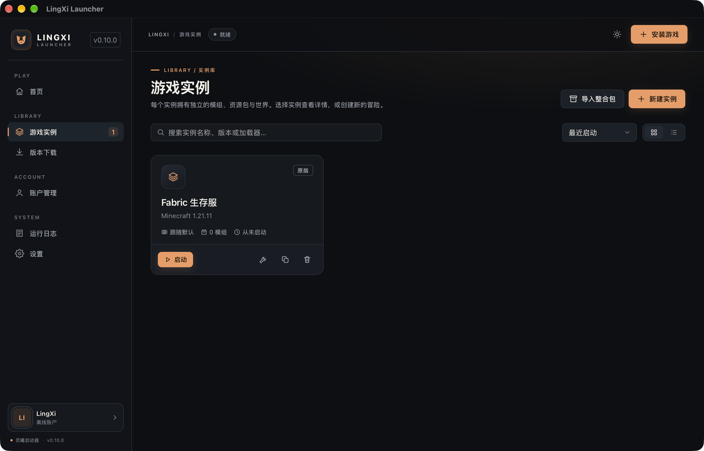 |
| 下载 |  |
| 账户 |  |
| 日志 | 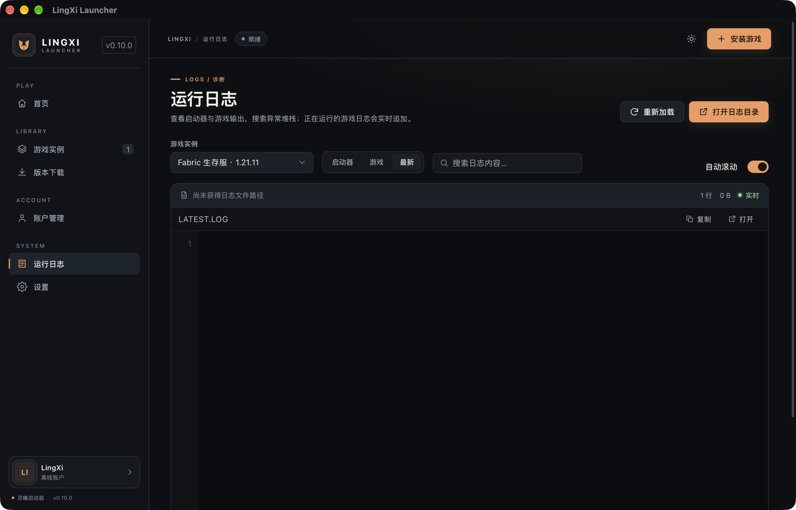 |
| 设置 | 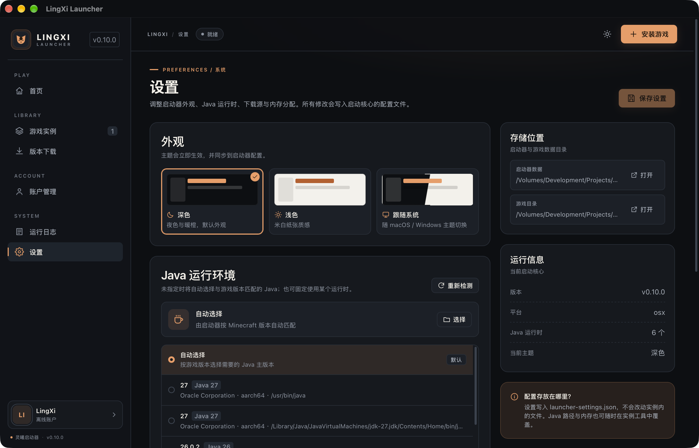 |
| 安装向导 | 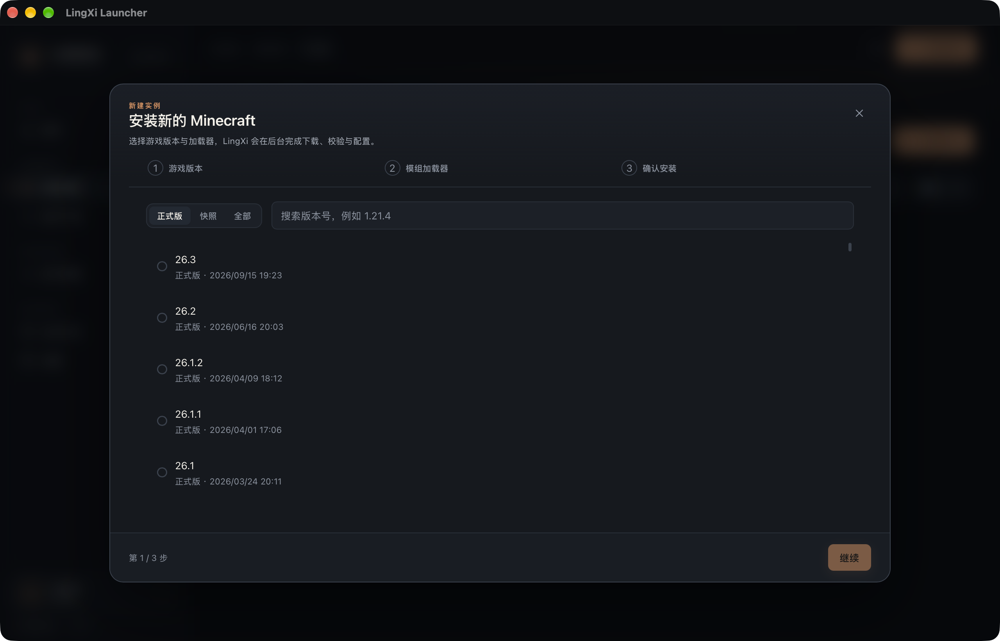 |
| 模组（已安装） | 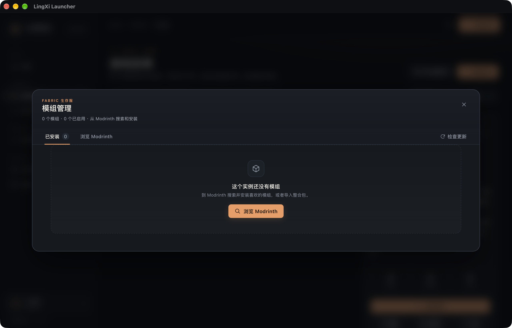 |
| 模组（Modrinth 搜索） | 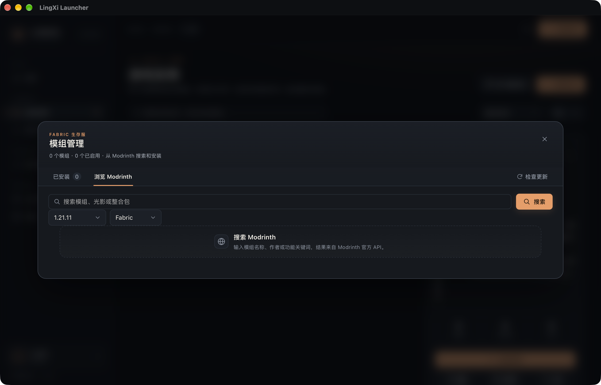 |
| 整合包导入 | 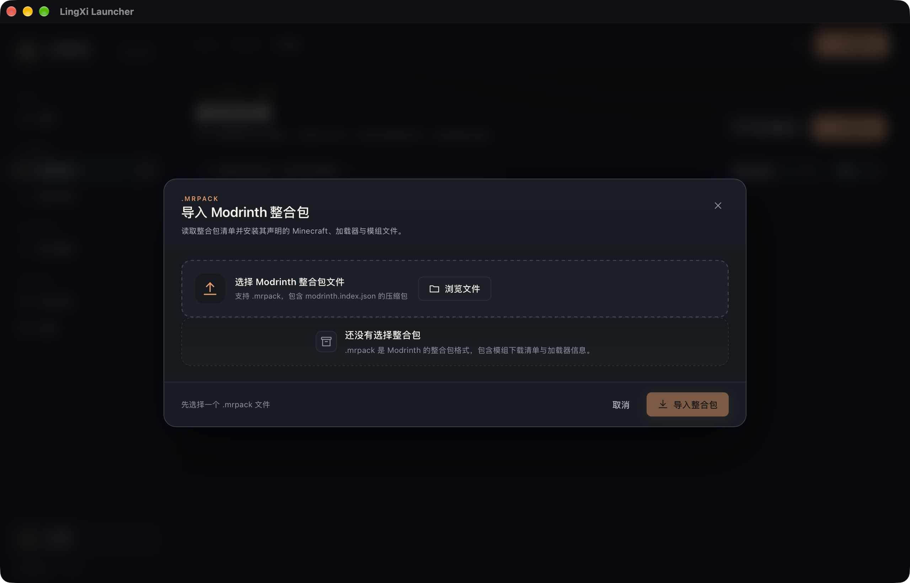 |
| 整合包更新 | 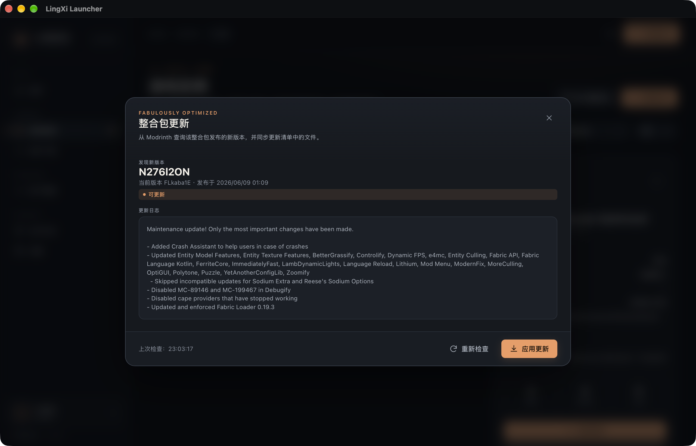 |
| 图形设置 | 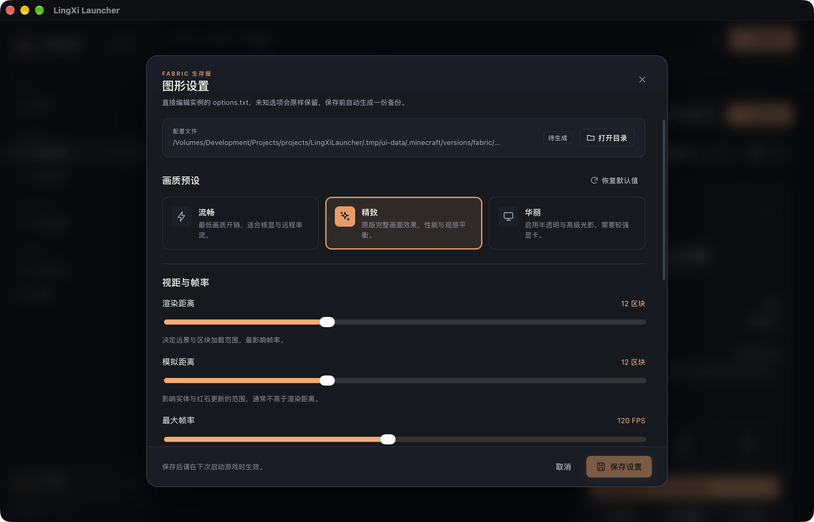 |
| 性能 | 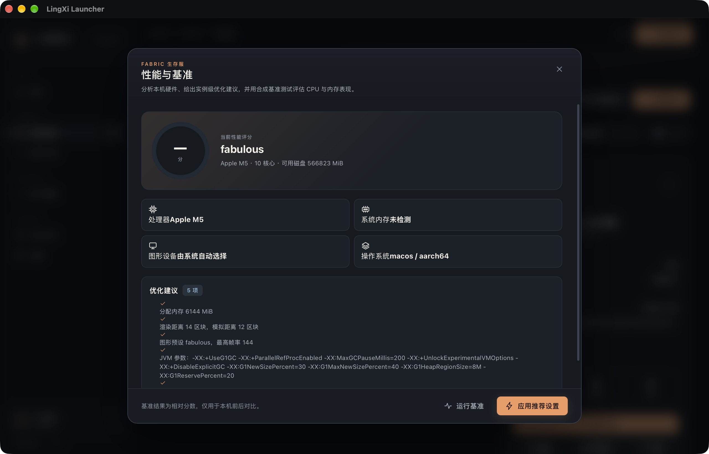 |
| 资源包 | 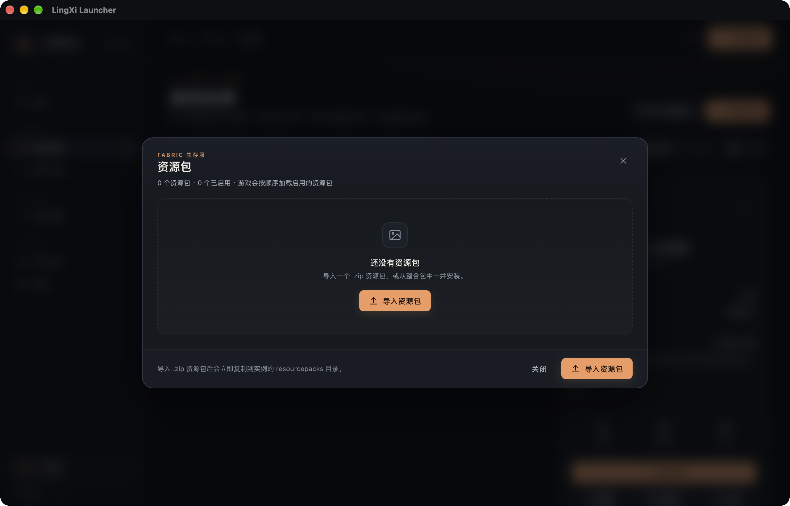 |
| 光影 | 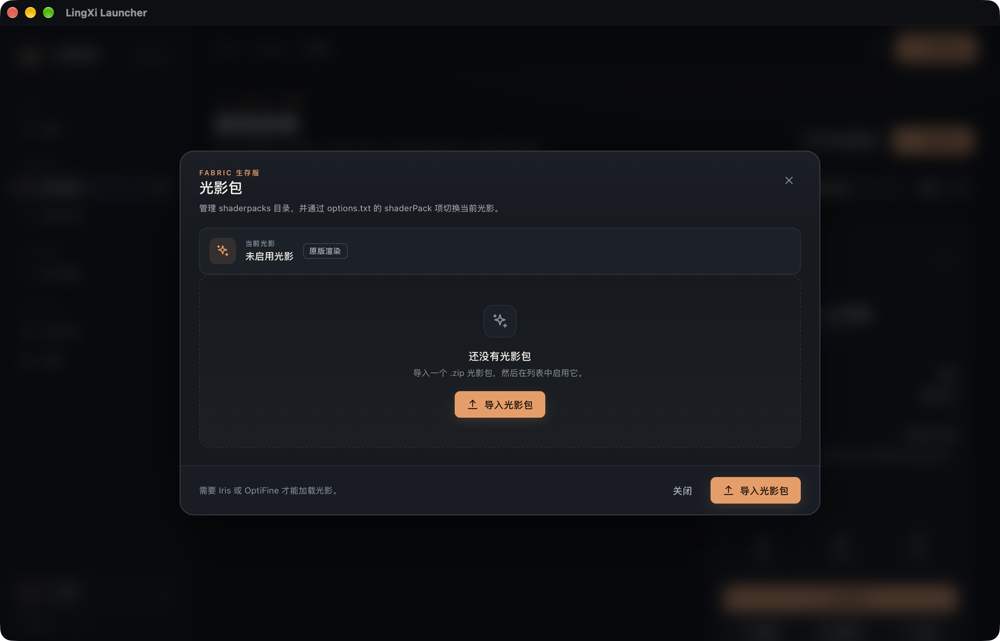 |
| 实例工具 · 实例设置 | 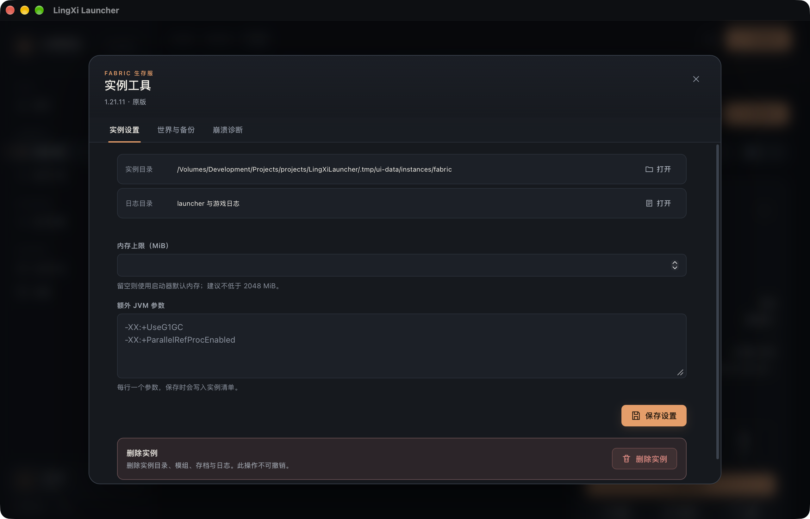 |
| 实例工具 · 世界与备份 | 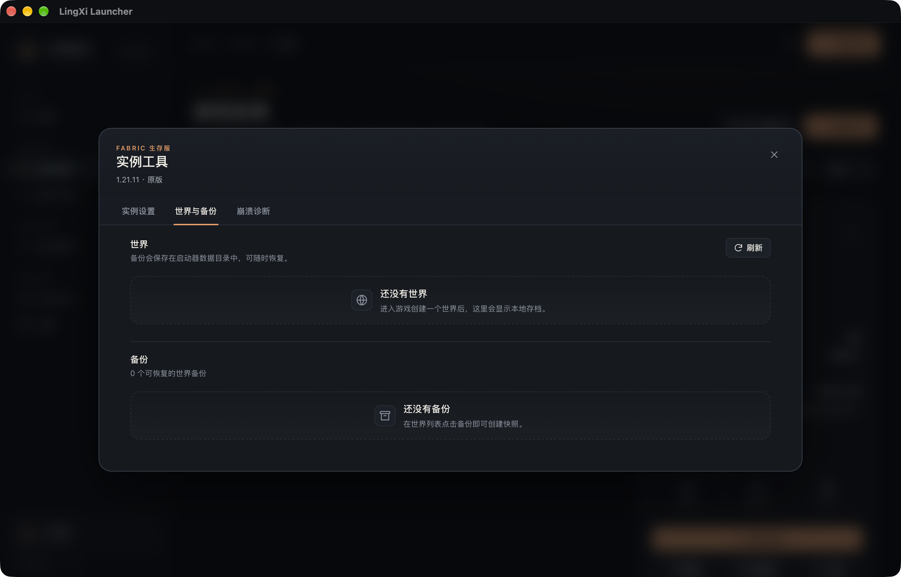 |
| 实例工具 · 崩溃诊断 | 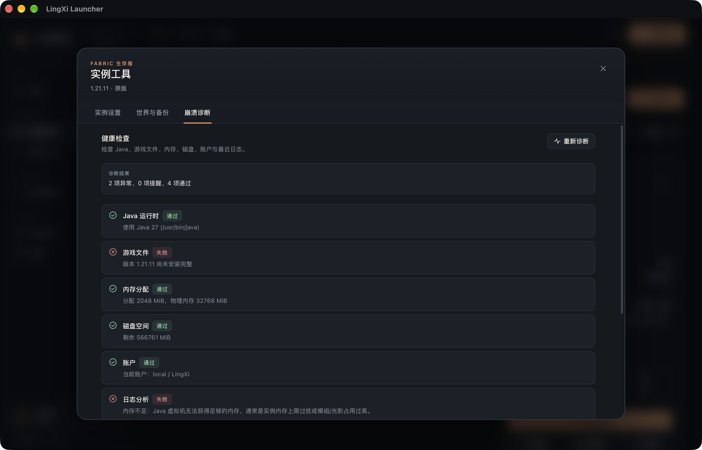 |
| 崩溃报告 | 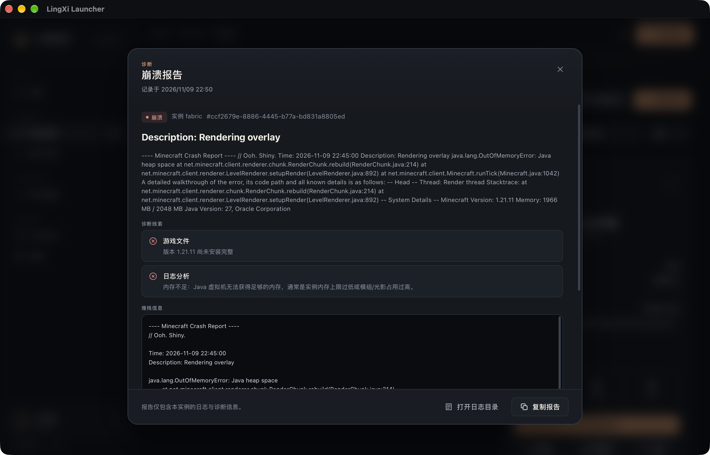 |

截图验证了版本清单加载（922 个版本）、实例卡片布局、真实 Modrinth 更新查询、真实 options.txt 编辑界面，以及基于真实崩溃日志的 OOM 诊断。mods-search.png 搜索框为空，因为 WebView 自动化注入没有让 React 受控输入生效，搜索请求由代码路径保证但未通过截图验证。
