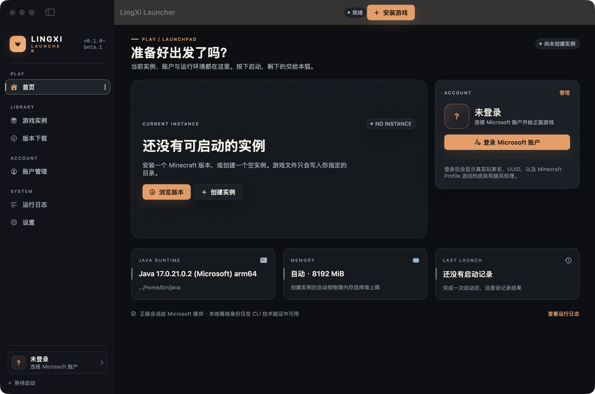
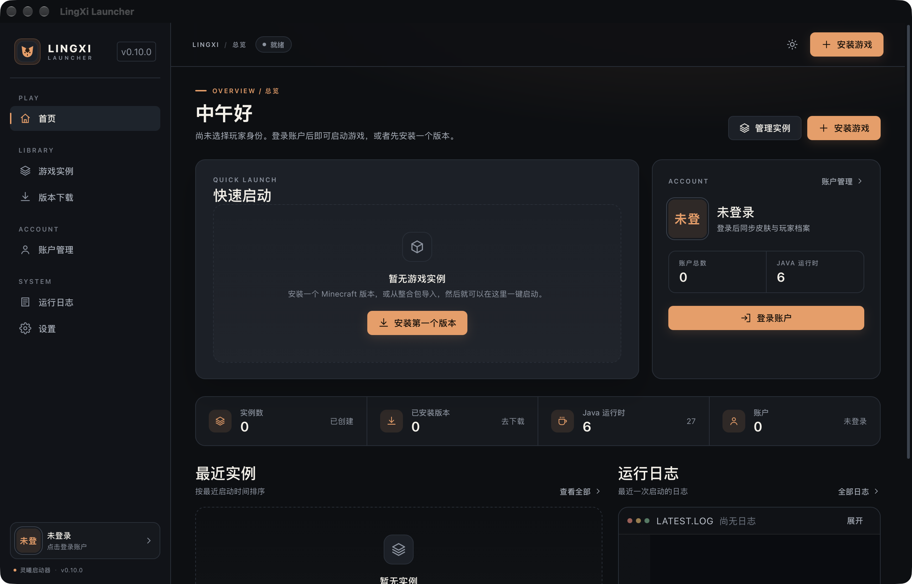

# 新旧界面视觉对比

本文件对照 SwiftUI 基线（tag `swift-implementation-before-removal`，commit `6aae3fd`）与 Rust + Tauri + React 实现（`rewrite/rust`，0.10.0）。

## 捕获条件

| 项目 | SwiftUI 基线 | Rust/Tauri |
| --- | --- | --- |
| 构建 | `swift build -c release --product LingXiMac` | `pnpm tauri build`（custom-protocol） |
| 应用版本 | 0.1.0-beta.1 | 0.10.0 |
| 系统 | macOS Apple Silicon | macOS Apple Silicon |
| 窗口 | 1240×820 | 1280×821 |
| 数据 | `/tmp/old-ui-data`、`/tmp/old-ui-game`（空） | `/tmp/new-ui-data`、`/tmp/new-ui-game`（空） |
| 截图 | `screencapture -l <window>`，Retina 2× | 同左 |

## 首页对照

| SwiftUI 基线 | Rust + Tauri |
| --- | --- |
|  |  |

## 结论

保留的视觉语言：

- 深色底 + 橙色强调色，卡片式信息层级。
- 左侧 Sidebar 分组 PLAY / LIBRARY / ACCOUNT / SYSTEM，底部账户入口。
- 左上角品牌区、窗口内版本号、顶部操作区与窗口标题栏。
- 中文界面、圆角、细边框、状态胶囊与图标体系。

Rust 版的增量：

- 首页从单一启动面板扩展为「快速启动 + 账户快照 + 四项统计 + 最近实例 + 运行日志」的信息布局。
- 顶部增加面包屑与主题切换；按钮、标签、空态统一到一套组件。
- 实例、账户、设置、工具等页面与 10 类弹窗均已有真实截图，见 [UI-PARITY.md](UI-PARITY.md#实际界面截图)。
- 打包后的 `LingXi Launcher.app` 启动截图：[packaged-app.png](screenshots/packaged-app.png)。

## 限制

- SwiftUI 旧版进程在 macOS 上无法通过 System Events 或 CGEvent 自动点击（权限违例 `-10004`），因此旧版只采集到首页；其余页面的视觉对照以 [UI-PARITY.md](UI-PARITY.md) 的 Rust 截图与 Swift 源码布局说明为准。
- 对照图为空数据状态，未注入模拟实例或账户。
